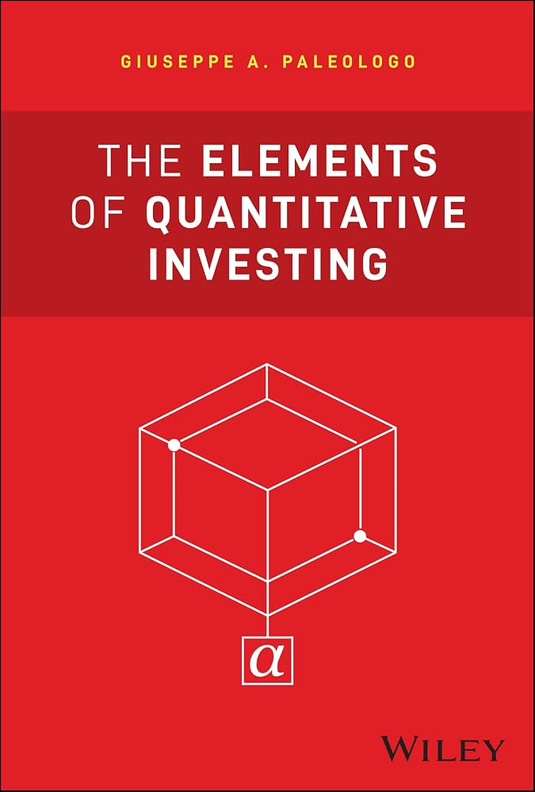

# EQI - The Elements of Quantitative Investing
The Elements of Quantitative Investing bt *Giuseppe A. Paleologo*

>
> *"To Tofu, again"*
>
> — Gappy

  

This repository is meant to serve a programmatic approach to all topics covered in the *Elements of Quantitative Investing*. The results can be found within the notebooks which are done chapter by chapter. The goal is to replicate and verify the results and create a programmatic framework. Since equity factors and signals are difficult to find at times random weighting schemes and generic long-only factors are used. All of the data is collected from Yahoo Finance to ensure reproducibility.

## Status

Chapter 4 — Linear Models of Returns 

| Subsection | Status |
|:---|:---|
| 4.1 — Factor Models | Pending |
| 4.2 — Interpretations of Factor Models | Pending |
| 4.3 — Alpha Spanned and Alpha Orthogonal | Pending |
| 4.4 — Transformations | Pending |
| 4.5 — Applications | Pending |

